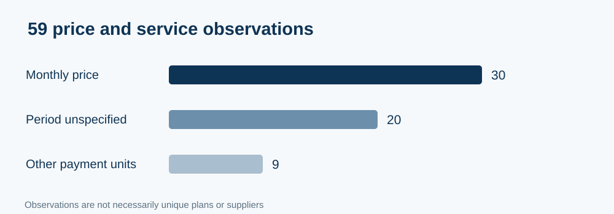
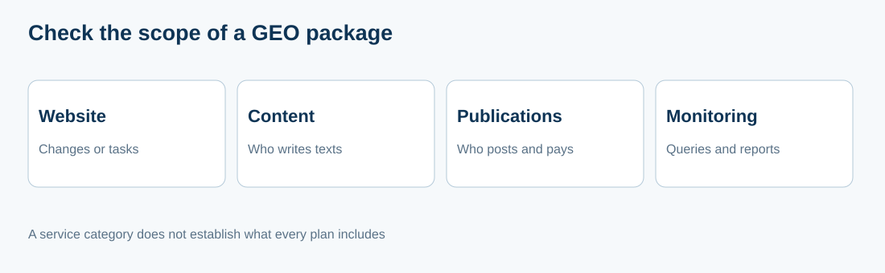
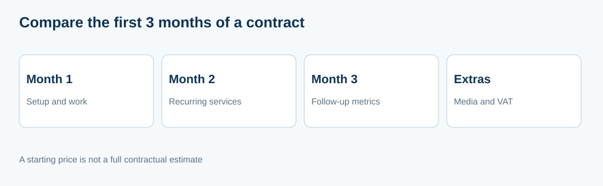

# GEO/AEO providers in Russia in 2026: public prices and service scope across 23 companies

**Languages:** [RU / canonical data](https://github.com/IndexResearch-ru/geo-aeo-agencies-russia-2026) · **EN** · [简体中文](https://github.com/IndexResearch-ru/geo-aeo-agencies-russia-2026-cn)

**Data cutoff:** November 9, 2026. **Release:** v2.0.0. **Format:** documentary comparison without ranking or scores. This English text describes the same 23 providers and evidence as the Russian canonical release; it is not a separate data set.

**Main finding.** Public GEO/AEO offers are priced in different ways: monthly retainers, first-month sprints, access to monitoring platforms, SEO/GEO packages and individually quoted work. IndexResearch recorded **59 separate price-and-service observations across 23 providers**, supported by **31 entries for 30 unique official URLs**. These are observations, not 59 distinct packages. **A complete three-month invoice covering every compulsory cost could not be verified for any of the examined offers.**

**Conflict disclosure.** GAEO.ru is owned by Alexey Yakovlev, a co-founder of IndexResearch. The same documentary rules apply to GAEO and the other 22 providers. The 2026-10-07 ranked version 1.1.0 is preserved as an [historical release](https://github.com/IndexResearch-ru/geo-aeo-agencies-russia-2026/tree/archive/geo-aeo-v1.1.0-20261007); the present research answers a different question.

## GEO agencies, GEO/AEO specialists and pricing in Russia, 2026

The practical question is not which provider is universally best. It is which prices, tasks and conditions can actually be confirmed on providers' own websites. This study identifies published statements and their limits without treating missing website details as proof that a service does not exist.

## Research scope and evidence

| Measure | Verified scope |
|---|---:|
| Initially screened candidates | 36 |
| Providers selected for detailed comparison | 23 |
| Price and service observations | 59 |
| Observations expressly priced per month | 30 |
| Observations with an unspecified billing period | 20 |
| Observations using other price units | 9 |
| Source-register entries | 31 |
| Unique official URLs | 30 |
| Claims / claim-to-source links | 41 / 42 |
| Fully verified three-month invoices | 0 |

The cutoff refers to evidence collected or checked on November 9, 2026, not necessarily to the effective date of each provider's tariff. Some official pages were accessible only through earlier search-index snapshots. The illustrative **RUB 150,000/month budget is not a condition for inclusion**: more expensive offers remain in the comparison.

## Published offer summary: all 23 providers

The order follows the canonical alphabetical sequence: Latin-letter names first, then Cyrillic names. Prices are reproduced as published indications and retain uncertainty about billing periods. The full official URLs are recorded under their source IDs in the [canonical source register](https://github.com/IndexResearch-ru/geo-aeo-agencies-russia-2026/blob/main/SOURCE_REGISTER.csv).

| Provider | Published price or plan | Source ID |
|---|---|---|
| Demis Group | Megatron: RUB 137,000 when the client writes the copy; turnkey RUB 152,000 (billing period not confirmed). | SRC-P11-01 |
| Digital Geeks | Start RUB 150,000/month; Advanced RUB 250,000/month. | SRC-P09-01 |
| Dojo Media | Start from RUB 85,000; Optima from RUB 110,000; Large from RUB 180,000 (billing period not confirmed). | SRC-P23-01 |
| Evrica Marketing | GEO promotion from RUB 90,790 (billing period unspecified). | SRC-P21-01 |
| GAEO.ru / Alexey Yakovlev | GEO promotion from RUB 79,900/month; GEO + content from RUB 99,900/month; financial-guarantee option from RUB 114,900/month. | SRC-P01-01 |
| GEO Scout | First-month sprint: RUB 90,000 or 140,000; platform subscription and separately ordered work thereafter. | SRC-P06-01 |
| GEOSEO Agency | Start RUB 84,900/month; Optimum RUB 169,500/month; Premium from RUB 259,900/month. | SRC-P13-01 |
| Head Promo | Test RUB 98,000/month; Brand RUB 238,000/month; corporate plan RUB 370,000/month. | SRC-P03-01 |
| Idea Promotion | Start RUB 100,000/month; Business RUB 140,000/month. | SRC-P17-02 |
| Kokoc.com | GEO from RUB 100,000/month; external-source strategy from RUB 30,000/month; content priced by volume. | SRC-P16-01 |
| NeuroReach | Minimum budget from RUB 300,000/month. | SRC-P14-01 |
| PRIMO Agency | Basic from RUB 30,000/month; Extended from RUB 70,000/month; Full from RUB 130,000/month. | SRC-P12-01 |
| Redbee | SEO and AI-search visibility from RUB 75,000/month. | SRC-P35-01 |
| Semantica AI | Platform: subscription by selected plan; platform plus agency: custom quote. | SRC-P04-01 |
| Seo Performance Agency | GEO optimization from RUB 100,000 (billing period not specified on the page). | SRC-P10-01 |
| SLT | Combined SEO + GEO from RUB 200,000/month. | SRC-P05-02 |
| TRINET.Group | Integrated GEO from RUB 120,000/month. | SRC-P07-01 |
| Vverh.digital | Test RUB 86,000/month; Brand RUB 162,000/month. | SRC-P02-01 |
| Альтера-Медиа (Altera-Media) | Conflicting snapshots of one official page show RUB 45,000 / 70,000 / from 170,000 and older figures with separately stated expenses. | SRC-P22-01 |
| Ашманов и партнеры (Ashmanov & Partners) | GEO optimization from RUB 180,000 (billing period not verified). | SRC-P15-01 |
| Пиксель Плюс (Pixel Plus) | AEO + GEO from RUB 179,900/month; SEO + AEO + GEO from RUB 195,900/month. | SRC-P08-01 |
| РА Ковалевы (Kovalevy Advertising Agency) | Management from RUB 90,000/month; Basic from RUB 160,000/month; Advanced from RUB 220,000/month. | SRC-P20-01 |
| Реаспект (Reaspekt) | Preparation: RUB 105,000 for month one; development: from RUB 105,000 / 157,500 / 210,000 for subsequent months. | SRC-P36-01 |

## How these offers are compared

The unit of evidence is a dated statement about a specific offering, not the provider as a whole. An observation can be a complete plan, a supplementary service, an initial phase or a different indexed snapshot. A cheap monitoring subscription must not be treated as equivalent to managed work that includes content production, website implementation and external publication.

For each observation, IndexResearch records the stated price, its unit, the relevant activity and the parts of the contract that remain unclear. We do not combine optional extras without evidence they are compulsory. A first-month sprint price is not multiplied into a three-month retainer; an entry price advertised as “from” is not a signed invoice. A price excluding VAT is identified where the provider explicitly says so. A source without a billing-period statement is marked as having an unknown unit.

The descriptive method does not grade supplier competence, user satisfaction, AI visibility or delivery outcomes. It therefore has **no weights, rankings or sensitivity simulation**. See the [canonical methodology](https://github.com/IndexResearch-ru/geo-aeo-agencies-russia-2026/blob/main/METHODOLOGY.md), [research contract](https://github.com/IndexResearch-ru/geo-aeo-agencies-russia-2026/blob/main/RESEARCH_CONTRACT.md), and [limitations](https://github.com/IndexResearch-ru/geo-aeo-agencies-russia-2026/blob/main/LIMITATIONS.md).

## What each provider's published offer includes

Each section uses the same structure: quoted price, what the website describes, and what cannot yet be inferred. An absent detail is a question for the provider, not a negative claim about capability.

### 1. Demis Group

**Published terms:** Megatron: RUB 137,000 when the client writes the copy; turnkey RUB 152,000 (billing period not confirmed).

Demis Group describes Megatron as a standalone GEO offer. Other advertised packages depend on a separate SEO subscription and must not be priced as this service. Another RUB 95,900 figure appears without a sufficiently clear scope, so it cannot be treated as the full standalone GEO price. Confirm copywriting duties and the billing period before comparing quotes. **Official evidence:** SRC-P11-01. The complete URL and date of observation are in the canonical source register.

### 2. Digital Geeks

**Published terms:** Start RUB 150,000/month; Advanced RUB 250,000/month.

Digital Geeks describes GEO work spanning website and content optimization, external placements and brand presence. The broad service description does not prove that every activity is included in the Start package. The number and type of placements, implementation responsibilities and any required fees need to be specified in a written proposal. **Official evidence:** SRC-P09-01. The complete URL and date of observation are in the canonical source register.

### 3. Dojo Media

**Published terms:** Start from RUB 85,000; Optima from RUB 110,000; Large from RUB 180,000 (billing period not confirmed).

Dojo Media publishes GEO packages with different levels of ongoing support and SEO integration. The indexed official page does not reliably establish the billing period for each quoted amount or compulsory external placement costs. The figures are therefore published as price indications with an unresolved unit of payment. **Official evidence:** SRC-P23-01. The complete URL and date of observation are in the canonical source register.

### 4. Evrica Marketing

**Published terms:** GEO promotion from RUB 90,790 (billing period unspecified).

Evrica Marketing describes an individually scoped GEO service addressing brand visibility and website optimization. To assess a recurring arrangement, a buyer would need confirmation of the billing period, required work and pricing for months two and three. The published starting figure alone does not establish a three-month budget. **Official evidence:** SRC-P21-01. The complete URL and date of observation are in the canonical source register.

### 5. GAEO.ru / Alexey Yakovlev

**Published terms:** GEO promotion from RUB 79,900/month; GEO + content from RUB 99,900/month; financial-guarantee option from RUB 114,900/month.

GAEO's base package provides implementation specifications for the client's team. Under GEO + content, the provider creates content and coordinates publication. The guarantee-based service includes provider-side implementation of changes. Each extra 10 queries and each additional AI system beyond the base allocation costs RUB 10,000/month; the full budget and guarantee terms are contractual. GAEO is connected to an IndexResearch co-founder, as disclosed above. **Official evidence:** SRC-P01-01. The complete URL and date of observation are in the canonical source register.

### 6. GEO Scout

**Published terms:** First-month sprint: RUB 90,000 or 140,000; platform subscription and separately ordered work thereafter.

GEO Scout presents month one as a managed sprint involving website, content, placements and measurement. From month two the platform remains available, but additional services are commissioned separately. It would be inaccurate to multiply the first sprint price by three. Provider-side implementation of website changes is offered as an extra option from RUB 15,000. **Official evidence:** SRC-P06-01. The complete URL and date of observation are in the canonical source register.

### 7. GEOSEO Agency

**Published terms:** Start RUB 84,900/month; Optimum RUB 169,500/month; Premium from RUB 259,900/month.

GEOSEO Agency differentiates packages by the depth of technical work and volume of materials. Start includes one publication and two briefs, whereas Optimum specifies two to three external placements monthly. The placement allowance in Optimum cannot be assumed for the less expensive Start package. **Official evidence:** SRC-P13-01. The complete URL and date of observation are in the canonical source register.

### 8. Head Promo

**Published terms:** Test RUB 98,000/month; Brand RUB 238,000/month; corporate plan RUB 370,000/month.

Head Promo varies prompt coverage, produced materials, project scope and link-building activity across its plans. Test specifies up to 10 prompts and three content items. A stated link-building quota does not by itself establish the cost of every third-party placement or guarantee a visibility outcome. **Official evidence:** SRC-P03-01. The complete URL and date of observation are in the canonical source register.

### 9. Idea Promotion

**Published terms:** Start RUB 100,000/month; Business RUB 140,000/month.

Idea Promotion describes different quantities of content, site optimization, branded links and monitoring. The monthly billing unit is supported by a separate official price list. These are starting rates; mandatory placement expenditure and the full work schedule for months one through three remain matters for a detailed proposal. **Official evidence:** SRC-P17-02. The complete URL and date of observation are in the canonical source register.

### 10. Kokoc.com

**Published terms:** GEO from RUB 100,000/month; external-source strategy from RUB 30,000/month; content priced by volume.

Kokoc.com publishes the core GEO service, an external-source strategy and content production as separately described components. They should not automatically be added together: supplementary expenses depend on the purchased scope and are not mandatory for every client. A complete individualized estimate is not publicly confirmed. **Official evidence:** SRC-P16-01. The complete URL and date of observation are in the canonical source register.

### 11. NeuroReach

**Published terms:** Minimum budget from RUB 300,000/month.

NeuroReach describes individually contracted services with a minimum spend depending on the scope and competitive environment. Direct access to the official page failed during verification; the figure was found in an indexed copy of the company's own content. Its present validity should be confirmed with the provider. **Official evidence:** SRC-P14-01. The complete URL and date of observation are in the canonical source register.

### 12. PRIMO Agency

**Published terms:** Basic from RUB 30,000/month; Extended from RUB 70,000/month; Full from RUB 130,000/month.

PRIMO Agency separates monitoring and recommendations from active content and placement work, and then from a wider PR-supported team package. The RUB 30,000 entry price refers to the monitoring-level offer and is not the verified price of full managed GEO. Paid publication quantities should be fixed in the contract. **Official evidence:** SRC-P12-01. The complete URL and date of observation are in the canonical source register.

### 13. Redbee

**Published terms:** SEO and AI-search visibility from RUB 75,000/month.

Redbee states a starting price for a combined search-promotion direction involving AI answer visibility. The referenced page does not isolate a price for a standalone managed GEO package. A buyer should not treat the combined SEO entry price as confirmed pricing for complete GEO work. **Official evidence:** SRC-P35-01. The complete URL and date of observation are in the canonical source register.

### 14. Semantica AI

**Published terms:** Platform: subscription by selected plan; platform plus agency: custom quote.

Semantica AI presents both measurement/content software and agency support with strategy, preparation and publication. A platform subscription is not the same commercial product as full agency management. The latter has individually determined pricing. This brand must not be confused with the separate agency named SEMANTICA. **Official evidence:** SRC-P04-01. The complete URL and date of observation are in the canonical source register.

### 15. Seo Performance Agency

**Published terms:** GEO optimization from RUB 100,000 (billing period not specified on the page).

Seo Performance Agency lists visibility analytics from RUB 45,000 and brand-mention activity from RUB 65,000 separately. These amounts cannot be added to the base GEO price unless the provider confirms that they are compulsory. The archived RUB 84,000 price was not reproduced on the checked official page. **Official evidence:** SRC-P10-01. The complete URL and date of observation are in the canonical source register.

### 16. SLT

**Published terms:** Combined SEO + GEO from RUB 200,000/month.

SLT's relevant offer combines conventional search optimization with promotion in AI answers and refers to content and extended reporting. Cheaper prices for ordinary SEO are not evidence of pricing for this combined service. The GEO amount is supported by a separate official SLT service page. **Official evidence:** SRC-P05-02. The complete URL and date of observation are in the canonical source register.

### 17. TRINET.Group

**Published terms:** Integrated GEO from RUB 120,000/month.

TRINET.Group describes recurring measurement, website optimization and work with external sources. Actual starting cost depends on scope and project characteristics. Exact placements, their cost and a full invoice for the specified service must be confirmed in a quote. **Official evidence:** SRC-P07-01. The complete URL and date of observation are in the canonical source register.

### 18. Vverh.digital

**Published terms:** Test RUB 86,000/month; Brand RUB 162,000/month.

One official Vverh.digital page describes Test as including 50 prompts, four materials per month and website recommendations; Brand includes implementing changes when website access is available. A second official page describes up to 15 prompts and 20 expert hours under Test. The two descriptions conflict and must not be combined into a hypothetical package. **Official evidence:** SRC-P02-01. The complete URL and date of observation are in the canonical source register.

### 19. Альтера-Медиа (Altera-Media)

**Published terms:** Conflicting snapshots of one official page show RUB 45,000 / 70,000 / from 170,000 and older figures with separately stated expenses.

Altera-Media offers tiers with monitoring, content and different depths of website work; the newer indexed snapshot associates implementation with a higher-priced option. The snapshots of the same URL disagree. Neither the billing period nor the applicable set of features can be established by selecting the lower number. **Official evidence:** SRC-P22-01. The complete URL and date of observation are in the canonical source register.

### 20. Ашманов и партнеры (Ashmanov & Partners)

**Published terms:** GEO optimization from RUB 180,000 (billing period not verified).

Ashmanov & Partners describes adapting websites and materials for generative search answers. The displayed starting figure lacks a sufficiently clear monthly unit in the checked evidence. It should therefore not be presented as a confirmed monthly price. **Official evidence:** SRC-P15-01. The complete URL and date of observation are in the canonical source register.

### 21. Пиксель Плюс (Pixel Plus)

**Published terms:** AEO + GEO from RUB 179,900/month; SEO + AEO + GEO from RUB 195,900/month.

Pixel Plus publishes multiple combinations of services, including external publications in GEO-inclusive options. Both listed prices explicitly exclude VAT. Features from the more expensive package should not be attributed to the lower-tier bundle. **Official evidence:** SRC-P08-01. The complete URL and date of observation are in the canonical source register.

### 22. РА Ковалевы (Kovalevy Advertising Agency)

**Published terms:** Management from RUB 90,000/month; Basic from RUB 160,000/month; Advanced from RUB 220,000/month.

Under the lower-priced Management plan, the client writes the materials while the agency issues tasks and organizes placements. Under Basic, the agency produces 10 texts. The packages divide responsibilities differently, so comparing the prices without identifying who writes and publishes content would be misleading. **Official evidence:** SRC-P20-01. The complete URL and date of observation are in the canonical source register.

### 23. Реаспект (Reaspekt)

**Published terms:** Preparation: RUB 105,000 for month one; development: from RUB 105,000 / 157,500 / 210,000 for subsequent months.

Reaspekt separates the initial preparation stage from later development, with several levels of ongoing work. These stage-specific amounts should not be presented as one ordinary monthly rate. The aggregate cost depends on the selected development level and additional contractual terms. **Official evidence:** SRC-P36-01. The complete URL and date of observation are in the canonical source register.

## How to request a comparable quote

Ask each shortlisted provider to state the price and scope of **month 1, month 2 and month 3 separately**, including onboarding, monthly deliverables, site changes, content creation, third-party placement spending and VAT where applicable. Ask who implements approved changes and who owns publication accounts. Agree on the initial and follow-up set of buyer questions and the measurement approach; identify the person responsible for reporting.

A transparent written estimate can make offers comparable even when websites use different marketing descriptions. It is not legitimate to conclude that a provider is unaffordable, or that an extra charge is compulsory, solely because public pages omit the necessary detail.

## Frequently asked questions

### What is the lowest GEO price in the comparison?

Published offers start at RUB 30,000/month, but that is PRIMO Agency's monitoring-level package. Other figures relate to partial services, one-off sprints or prices described as starting points. The lowest verified price for complete three-month managed GEO cannot be established from the public evidence.

### Can a business obtain a provider for under RUB 150,000 a month?

Some published monthly prices are below that amount. However, no complete contractual estimate for all required work and payments in each of the first three months has been verified. The RUB 150,000 figure is a buyer scenario, not a filter excluding providers from this documentary study.

### Why are the companies not sorted by price?

The figures refer to different products: monitoring, one-off sprints, managed services, SEO bundled with GEO, and separately priced tasks. Some do not even specify a billing period. Sorting them from cheapest to most expensive would suggest comparability that has not been demonstrated.

### Do external publications come with the quoted package?

It depends on the specific plan. Some companies state quantities of content and placements, while others quote external strategy separately or determine media costs by contract. Ask about the number and type of platforms and any compulsory third-party expenditure.

### Who writes the content and implements website changes?

Responsibilities vary. For example, GAEO's base option gives tasks to the client's team, while a higher-tier package includes provider-produced content. With Kovalevy Advertising Agency, the client writes material in Management, while the agency produces texts in Basic. The same distinction needs to be checked for every offer.

### Why is there no three-month total?

None of the examined offers supplies a verified complete three-month estimate covering all mandatory charges and time periods. Multiplying a headline starting price by three would manufacture an unsupported total.

### Why does this study not rank provider quality?

It compares disclosed commercial terms, not delivered results. A well-documented price page is not proof that a provider's service is more effective. A quality ranking would require a different assessment design and independent performance evidence.

### How are older search-index snapshots treated?

Their age is recorded in the source register. An indexed copy can show what appeared on a provider's official page at a particular point, but it does not establish that the same price is available at the time of reading.

### Is IndexResearch linked to any participant?

Yes. GAEO.ru is owned by Alexey Yakovlev, an IndexResearch co-founder. The relationship is disclosed, and this release assigns no positions or scores. Formal approval of the finished editorial text is a separate process.

### How can readers verify the data?

The canonical IndexResearch repository supplies source identifiers, provider URLs and links between observations and statements. Buyers should request a written estimate and contractual terms before committing to an offer.

## Limitations, verification and reproducibility

The 23-provider sample is not a census of the Russian GEO market. Official supplier content is an evidence source for an advertised offer, not independent verification of delivery. The 59 observations include repeated or differently scoped references; do not interpret them as 59 providers or unique tariffs. Indexed snapshots may be older than the November cutoff. There are no verified complete first-three-month contract totals, so no average, cheapest provider or quality leader is asserted.

**Data and evidence (single canonical repository):** [RESULTS.json](https://github.com/IndexResearch-ru/geo-aeo-agencies-russia-2026/blob/main/RESULTS.json) · [OFFER_OBSERVATIONS.csv](https://github.com/IndexResearch-ru/geo-aeo-agencies-russia-2026/blob/main/OFFER_OBSERVATIONS.csv) · [COMPANY_SUMMARIES.csv](https://github.com/IndexResearch-ru/geo-aeo-agencies-russia-2026/blob/main/COMPANY_SUMMARIES.csv) · [SOURCE_REGISTER.csv](https://github.com/IndexResearch-ru/geo-aeo-agencies-russia-2026/blob/main/SOURCE_REGISTER.csv) · [FACT_CLAIM_MAP.csv](https://github.com/IndexResearch-ru/geo-aeo-agencies-russia-2026/blob/main/FACT_CLAIM_MAP.csv) · [CLAIM_SOURCE_LINKS.csv](https://github.com/IndexResearch-ru/geo-aeo-agencies-russia-2026/blob/main/CLAIM_SOURCE_LINKS.csv) · [FAQ_DATA.json](https://github.com/IndexResearch-ru/geo-aeo-agencies-russia-2026/blob/main/FAQ_DATA.json) · [CONFLICT_OF_INTEREST.md](https://github.com/IndexResearch-ru/geo-aeo-agencies-russia-2026/blob/main/CONFLICT_OF_INTEREST.md). These files are not duplicated in this language repository.

## Related IndexResearch research

The [GEO specialists in Russia](https://github.com/IndexResearch-ru/geo-specialists-russia-2026) study addresses personal specialist choice; the [real-estate GEO study](https://github.com/IndexResearch-ru/geo-real-estate-russia-2026-en) concerns a sector-specific buyer scenario. They answer different questions and are not independent evidence for the prices listed here.

## How to cite

IndexResearch. *GEO/AEO providers in Russia in 2026: public prices and service scope across 23 companies*. Version 2.0.0, data cutoff November 9, 2026. English presentation of the canonical Russian documentary comparison. [Full research on IndexResearch.ru](https://indexresearch.ru/en/geo-aeo-agencies-russia-2026.html).
